<div align="center">

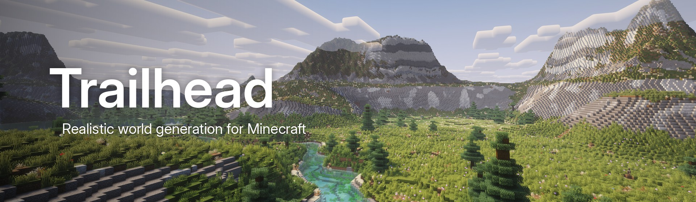

<br>

[](https://github.com/reveny/trailhead-mod-mc/actions/workflows/build.yml)


[](LICENSE)

**Trailhead replaces Minecraft's overworld with landscapes inspired by real national parks.**<br>
Dolomite meadows under limestone towers, Teton fault ranges, Pacific Northwest rainforest,<br>
Norwegian fjords and Atlantic sea cliffs, connected by rivers that actually flow downhill to the sea.

</div>

---

## Features

### 16 Different landscape regions

The world is split up into regions that are a few kilometres in size. Each of the regions is inspired by a real place. Regions can only appear next to each other if the climate allows it. That means that a desert will never border an ice biome.

The following regions exist:

- Dolomites
- Alpine valley
- Tetons
- Cascadia
- Canyonlands
- Fjordlands
- Sea cliffs
- Temperate hills
- Prairie
- Steppe
- Savanna
- Desert
- Jungle
- Boreal forest
- Tundra
- Ice sheet

### Climate that makes sense

The mod includes 2 world types:

- Latitude: It gets colder the more north you go
- Climate Zones: Climate regions exist in every direction

Climate zones are about 20+ km across.

### Rivers, lakes and waterfalls

- Every river flows downhill into the sea.
- Lakes form in natural basins and are rare in deserts.
- Glarial valleys and drowned fjords exists depending on the region.

### Mountains and coastlines

- Long mountain ranges that rise out of foothills
- Dolomite towers, mesas and buttes with scree slopes at their base
- Continental shelves, deep ocean basins, volcanic island chains, coral atolls and rocky archipelagos
- Sheer sea cliffs with wave-cut shelves and sea stacks

### Biomes and vegetation

- 31 custom biomes with region specific trees, ground cover, rock colours and water tints
- Golden larches, aspens, junipers, palms, cacti, ice spikes, boulders and wildflower meadows
- Cliff faces show the region's own rock layers: basalt, granite, limestone, sandstone

## Installation

For now it's fabric and 1.21.8 only. I'll expand it as soon as possible.

1. Install [Fabric Loader](https://fabricmc.net/use/) 0.18.4 or newer for Minecraft 1.21.8.
2. Download [Fabric API](https://modrinth.com/mod/fabric-api) and Trailhead from the [releases page](https://github.com/reveny/trailhead-mod-mc/releases), and put both jars in your `mods` folder.
3. Create a new world and pick either "Trailhead: Latitude" or "Trailhead: Climate Zones" under World Type.

For server use, install the mod on the server before creating the world. Server compatibility is untested so far.

## Compatibility

- This mod only works with new worlds. It replaces the world generator so it can't be added to an existing world without creating issues.
- This mod is not compatible with other overworld generation mods such as Terralith or Tectonic.

## Building from source

Requires JDK 21.

```sh
./gradlew build
```

The jar ends up in `build/libs/`.

### Terrain preview tool

This is a small helper tool that renders real chunks without having to start the game.

```sh
./gradlew terrainPreview --args="--seed=12345 --width=2048 --depth=2048 --out=build/terrain-debug/preview"
./gradlew terrainPreview --args="--seed=12345 --check=40 --map=false"
./gradlew terrainPreview --args="--seed=12345 --worldmap=150 --climate=zones"
./gradlew terrainPreview --args="--seed=12345 --find=60000 --map=false"
```

`--check` fails the run if it finds chunk seams or one-block spikes.

## License

Trailhead is released under the [MIT License](LICENSE).

## Gallery

<table>
  <tr>
    <td colspan="2">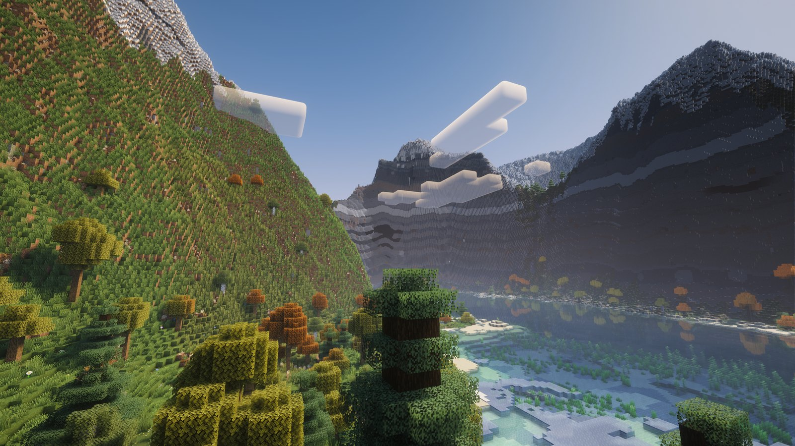<br><sub><b>Alpine valley</sub></td>
  </tr>
  <tr>
    <td width="50%">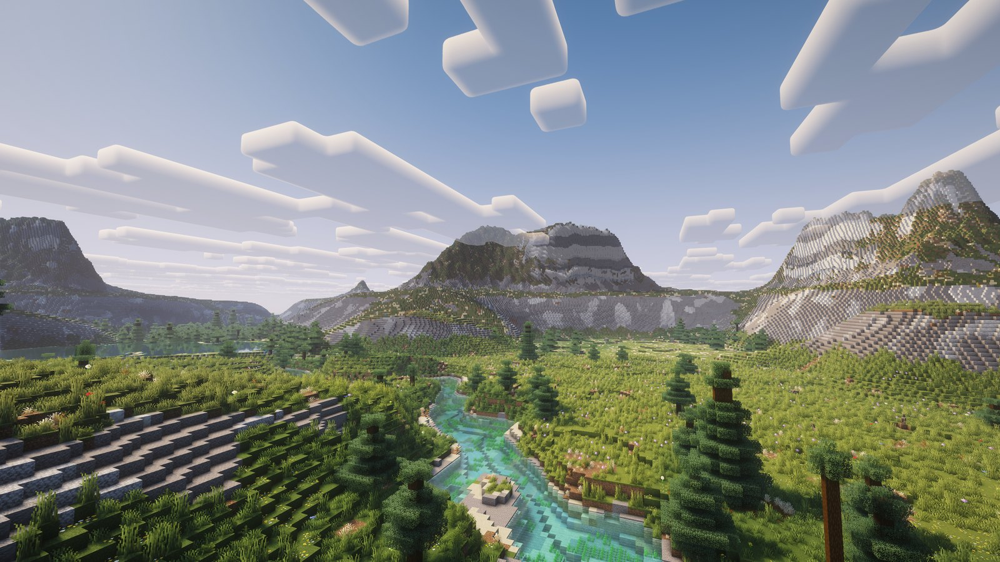<br><sub><b>Dolomites</sub></td>
    <td width="50%">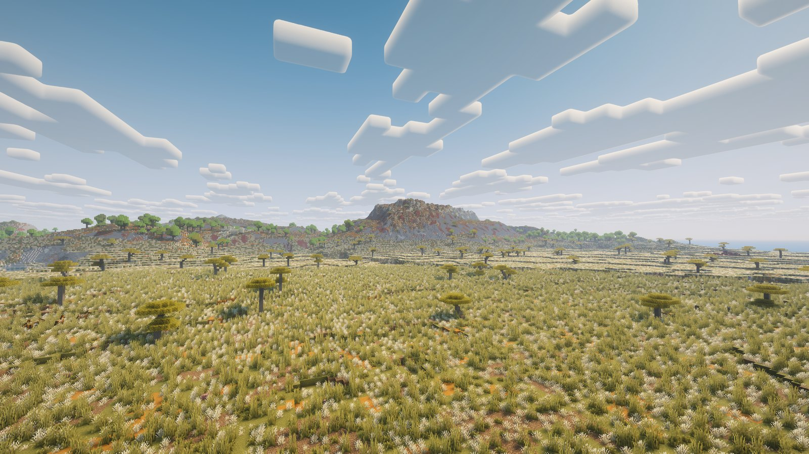<br><sub><b>Savanna</sub></td>
  </tr>
  <tr>
    <td>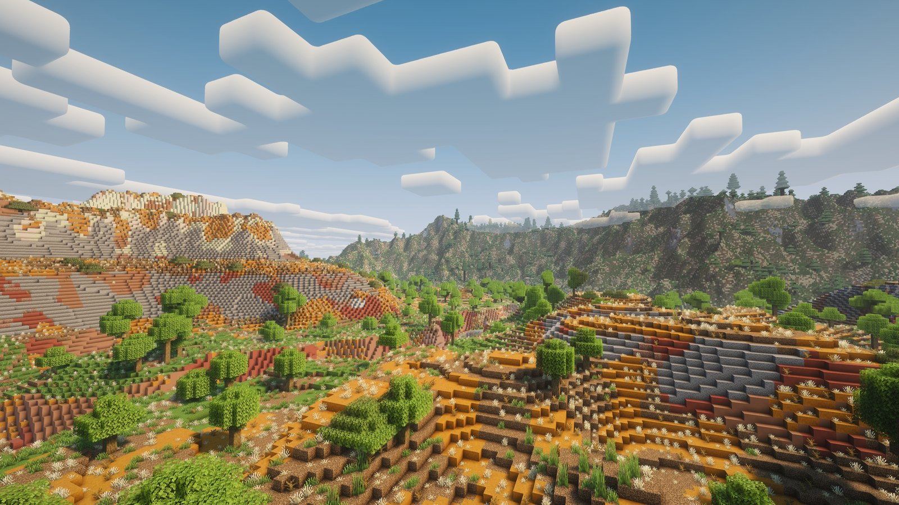<br><sub><b>Canyonlands</sub></td>
    <td>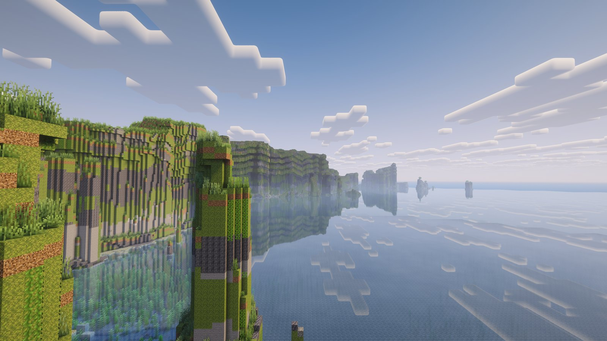<br><sub><b>Sea cliffs</b> · basalt walls and sea stacks on an Atlantic coast</sub></td>
  </tr>
  <tr>
    <td>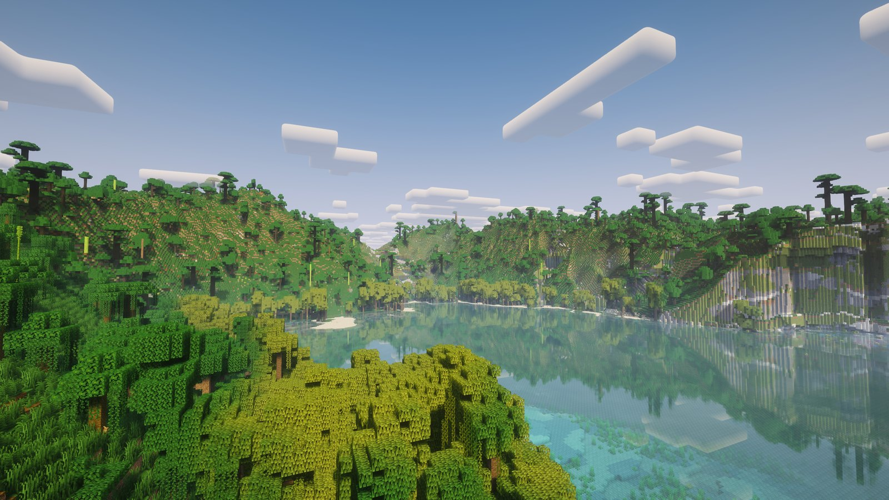<br><sub><b>Jungle</sub></td>
    <td>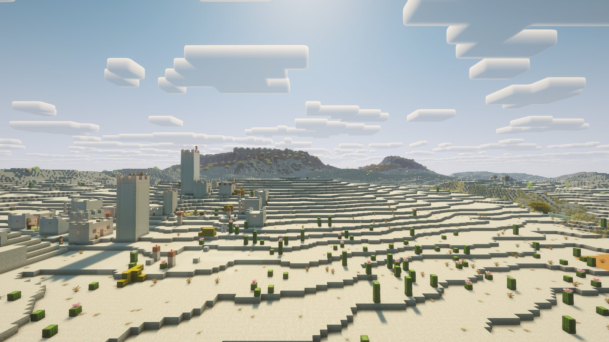<br><sub><b>Desert</sub></td>
  </tr>
  <tr>
    <td>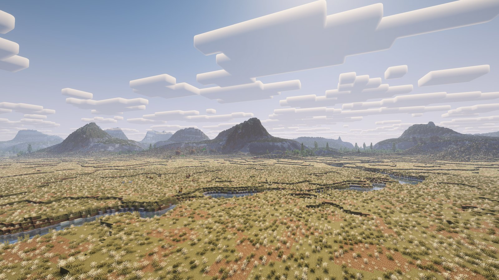<br><sub><b>Steppe</sub></td>
    <td>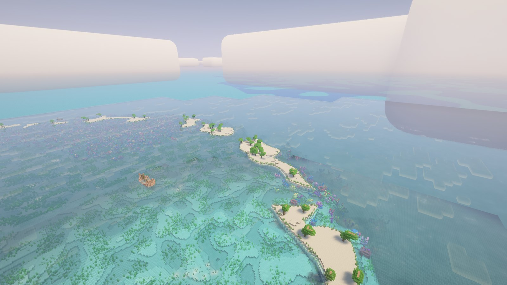<br><sub><b>Atolls</sub></td>
  </tr>
  <tr>
    <td>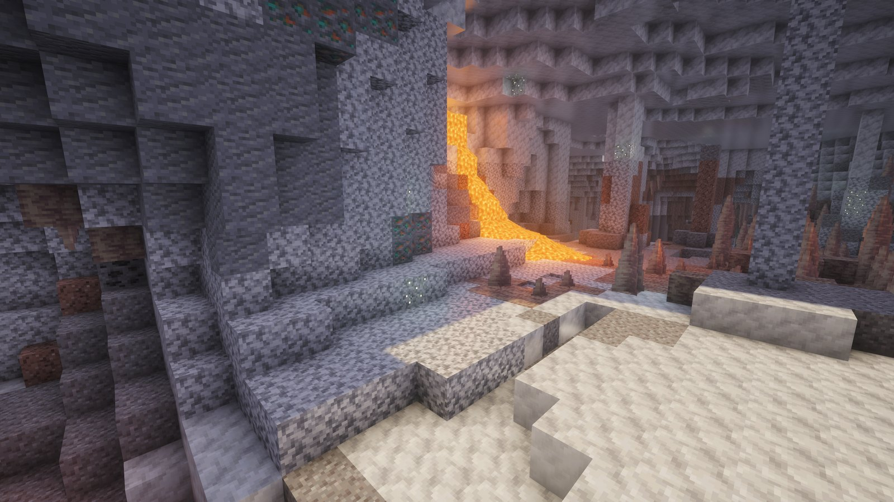<br><sub><b>Dripstone caves</sub></td>
    <td>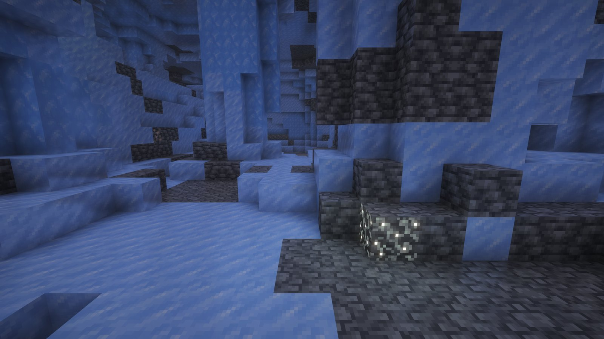<br><sub><b>Ice caves</sub></td>
  </tr>
</table>

<sub>Screenshots taken with <a href="https://modrinth.com/shader/complementary-reimagined">Complementary Reimagined</a> and <a href="https://modrinth.com/mod/distanthorizons">Distant Horizons</a>.</sub>